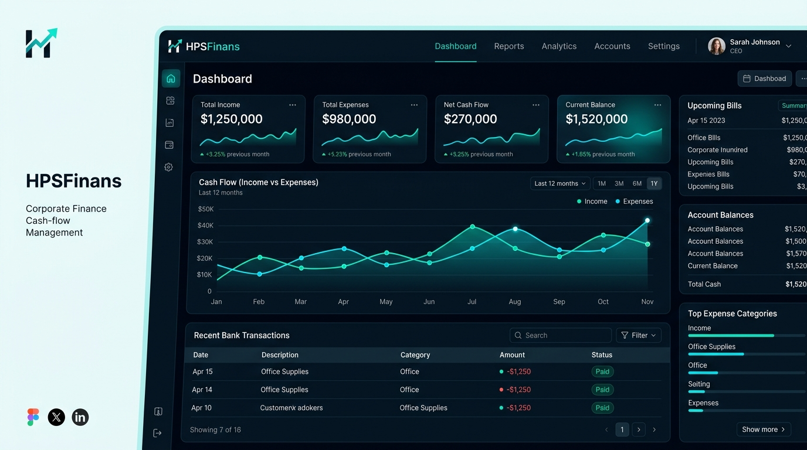

# 💼 HPSFinans — Modern KOBİ & Şirket Finans Yönetim Paneli

[](https://developer.mozilla.org/en-US/docs/Web/HTML)
[](https://developer.mozilla.org/en-US/docs/Web/CSS)
[](https://developer.mozilla.org/en-US/docs/Web/JavaScript)
[](https://www.chartjs.org/)
[](LICENSE)
[](https://yagmurinann.github.io/hpsfinans/)

**HPSFinans**, KOBİ'ler, girişimciler ve şirketler için tasarlanmış; gelir-gider hareketlerini, nakit akışını, banka hesaplarını, cari dengeleri ve finansal analizleri tek ekrandan takip etmeyi sağlayan modern, hızlı ve duyarlı (responsive) bir finans yönetim web uygulamasıdır.

Herhangi bir kurulum gerektirmeden, doğrudan web tarayıcısında çalışır ve tüm verileri yerel depolamada (**LocalStorage**) güvenle muhafaza eder.

---

## 📸 Ekran Görüntüsü / Önizleme



---

## 🚀 Canlı Demo

Uygulamayı tarayıcınızda hemen test etmek için:  
👉 **[HPSFinans Canlı Demo](https://yagmurinann.github.io/hpsfinans/)**

---

## 🌟 Temel Özellikler

### 📊 1. Akıllı Yönetim Paneli (Dashboard)
- **Kritik Metrik Kartları:** Anlık Toplam Kasa/Banka Bakiyesi, Bu Ayki Gelir, Bu Ayki Gider ve Net Nakit Akışı göstergeleri.
- **30 Günlük Nakit Akışı Grafiği:** Chart.js destekli, gün gün kümülatif nakit değişimini görselleştiren etkileşimli alan grafiği.
- **Yaklaşan İşlemler:** Vadesi bekleyen fatura ve ödemelerin hızlı özeti.
- **Son Hareketler:** En son işlenen gelir/gider kalemlerinin pratik listesi.

### 💸 2. Gelir & Gider Yönetimi
- **Tam CRUD:** Yeni işlem ekleme, detaylandırma, filtreleme ve silme.
- **Gelişmiş Arama & Filtre:** Açıklama, cari unvan veya kategoriye göre anında arama; Gelir/Gider ve Tamamlandı/Bekliyor filtreleri.
- **Kategorilendirme:** Satış, Hizmet, Kira, Lojistik, Tedarik, Yazılım vb. kategorilere göre ayrıştırma.
- **Banka & Cari Eşleştirme:** Her hareketi ilgili banka hesabı ve cari hesapla ilişkilendirme.

### 🏦 3. Banka Hesapları Takibi
- Çoklu banka ve kasa hesabı tanımlama.
- Başlangıç bakiyesinin üzerine işlenen hareketleri otomatik yansıtarak anlık computed bakiye sunumu.
- Banka hesabı ekleme ve güvenli silme desteği.

### 👥 4. Cari Hesap (Müşteri & Tedarikçi) Yönetimi
- Müşteri ve Tedarikçi türlerine göre cari kart açma.
- İletişim telefonu ve net bakiye (alacak / borç durumu) izleme.
- İlişkili işlemler için onay mekanizmalı silme güvenliği.

### 📅 5. Vade Takvimi (Yaklaşan Ödemeler & Tahsilatlar)
- Bekleyen tahsilatlar (alacaklar) ve bekleyen ödemelerin (borçlar) tarih sıralı takibi.

### 📈 6. Finansal Raporlar & Analizler
- **Son 6 Ay Gelir / Gider Karşılaştırması:** Çift sütunlu interaktif bar grafiği.
- **Gider Dağılımı (Kategori):** Hangi kategoriye ne kadar harcandığını gösteren halka (doughnut) pasta grafiği.
- **Cari Bakiye Konsolidasyonu:** Müşteri ve tedarikçilerin konsolide bakiye tablosu.

### 💾 7. Kalıcı Hafıza & Veri Yedekleme
- **LocalStorage:** Sayfayı yenilediğinizde veya tarayıcıyı kapattığınızda verileriniz kaybolmaz.
- **JSON Dışa Aktarma (Yedek İndir):** Tek tıkla veritabanınızı `hpsfinans_yedek_YYYY-MM-DD.json` formatında yedekleyin.

### 🌓 8. Karanlık & Aydınlık Tema
- Göz yormayan şık karanlık mod (Dark Mode) ve ferah aydınlık mod (Light Mode) seçeneği.
- Tema tercihi tarayıcıda hatırlanır ve grafik renkleri temaya dinamik olarak uyum sağlar.

---

## 🛠️ Teknoloji Yığını

| Alan | Teknoloji | Açıklama |
|---|---|---|
| **Yapı (Markup)** | HTML5 | Semantik etiketler, erişilebilirlik ve SEO uyumu |
| **Stil (Styling)** | Vanilla CSS | CSS Değişkenleri (:root vars), Glassmorphism, Responsive Grid |
| **Tipografi** | Google Fonts | Sora & Inter font aileleri |
| **Grafikler** | Chart.js 4.4.4 | Etkileşimli, animasyonlu nakit akışı ve rapor grafikleri |
| **İstemci Mantığı** | JavaScript (ES6+) | Reaktif durum yönetimi, dinamik filtreleme, hesaplama motoru |
| **Kalıcılık** | HTML5 LocalStorage | İstemci tarafı yerel veritabanı |

---

## 📁 Proje Dosya Yapısı

```
HPSFinans/
├── assets/
│   └── preview.jpg        # Proje önizleme görseli
├── index.html             # Ana uygulama dosyası (HTML, CSS, JS)
├── .gitignore             # Git versiyon kontrolü hariç tutma kuralları
├── LICENSE                # MIT Açık Kaynak Lisansı
└── README.md              # Kapsamlı proje dokümantasyonu
```

---

## 💻 Kurulum ve Çalıştırma

Projeyi yerel bilgisayarınızda çalıştırmak için herhangi bir paket yöneticisine veya bağımlılık kurulumuna gerek yoktur.

### Yöntem 1: Doğrudan Açma
1. Projeyi klonlayın:
   ```bash
   git clone https://github.com/yagmurinann/hpsfinans.git
   ```
2. `index.html` dosyasına çift tıklayarak herhangi bir modern taraycıda (Chrome, Edge, Firefox, Safari) açın.

### Yöntem 2: Canlı Sunucu ile Açma (Örn: VS Code veya Python)
```bash
# Python ile yerel sunucu başlatma
python -m http.server 3000
# veya Node.js npx ile:
npx serve
```
Ardından tarayıcınızdan `http://localhost:3000` adresine gidin.

---

## 🌐 GitHub Pages ile Canlı Yayına Alma Adımları

Projeyi kendi GitHub hesabınızda canlı web sitesi olarak yayınlamak için:

1. Deponuzun ana sayfasından **Settings** sekmesine tıklayın.
2. Sol menüden **Pages** bölümünü seçin.
3. **Build and deployment > Branch** kısmında:
   - Dal olarak: `main`
   - Dizin olarak: `/ (root)`
   - **Save** butonuna tıklayın.
4. 1-2 dakika içinde uygulamanız `https://yagmurinann.github.io/hpsfinans/` adresinde yayına girecektir.

---

## 📄 Lisans

Bu proje [MIT Lisansı](LICENSE) kapsamında lisanslanmıştır. Dilediğiniz gibi kullanabilir, geliştirebilir ve özelleştirebilirsiniz.

---

<p align="center">
  Geliştirici: <b>Yağmur İNAN</b> ✦ 2026
</p>
